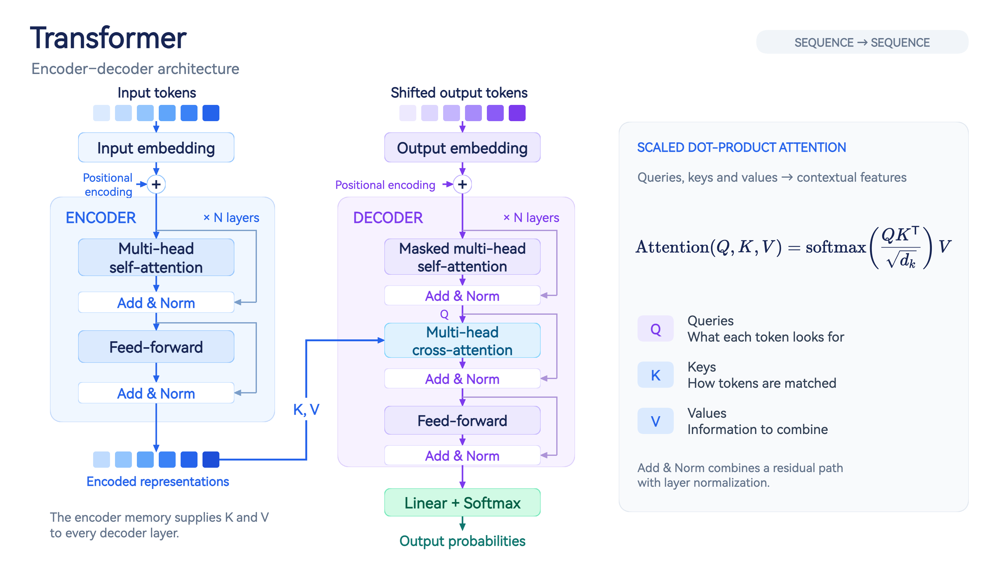

# FlowSketch

[English](README.en.md) | 简体中文

FlowSketch 是一个可直接在浏览器中运行的流程图与论文插图绘制工具，适合制作流程图、模型结构图、Token 矩阵和包含图片的技术示意图，项目使用可读写的 JSON 格式保存。

项目采用 HTML、CSS 和 JavaScript，没有构建步骤，编辑器不依赖应用后端。绘图、文件管理和导出均在浏览器内完成，运行所需的脚本、样式和字体随仓库提供。AI 助手是可选功能，默认将对话和画布上下文直接发送到用户配置的 API，也可选用本机转发工具；完整数据流向见[数据与隐私](#数据与隐私)。

## 在线试用

以下地址均可在线试用：

- [draw.lhye.work](https://draw.lhye.work/)
- [github.lhye.work/draw](http://github.lhye.work/draw)
- [lhy-cpu.github.io/draw](https://lhy-cpu.github.io/draw/)

在线版本使用浏览器本地文件库；使用 AI 时的数据流向见[数据与隐私](#数据与隐私)。



此图采用 16:9 画布，由 FlowSketch 在线编辑器绘制并导出，[查看实际编辑器截图](assets/readme-editor.jpg)。可将 [Transformer 示例 JSON](examples/transformer.json) 拖入编辑器继续修改。架构概念参考 [Attention Is All You Need](https://arxiv.org/abs/1706.03762)，图形布局为本项目制作。

## 主要能力

- 基础图形、块箭头、括号、文字、LaTeX 公式、便签和图片
- 可新建、加入、退出和取消的组合管理，以及按图层顺序自动堆叠
- 直线、自动/手动折线和带平滑控制杆的曲线连接线，首尾可独立选择 5 种箭头样式
- Token 矩阵、立体层叠、图片池化上色和 RGBA/彩色/灰度通道
- 多选、对齐、均匀分布、图层排序、旋转和八方向缩放
- 120 组内置配色，可应用到全图或当前选择
- 撤销、重做、复制、粘贴、右键菜单和常用快捷键
- 原生 PPTX、SVG、PNG、JSON 导出
- 浏览器内多文件管理、拖放导入和自动保存
- 可选 AI 助手：通过对话编辑画布，支持流式回复、工具调用和图片输入

## 开始使用

下载仓库后，保留 `index.html` 与 `assets/` 的相对位置，用现代桌面浏览器直接打开 `index.html` 即可使用基础绘图功能，无需安装 npm 依赖。

也可以在项目目录启动本地静态文件服务（需要 Python 3）：

```bash
python3 -m http.server 8765 --bind 127.0.0.1
```

然后访问 [http://127.0.0.1:8765](http://127.0.0.1:8765)。这个服务只用于提供静态文件，不提供项目上传或 AI 转发接口。固定访问地址有助于保持浏览器存储一致；直接打开文件时，存储、剪贴板和 API 跨域访问的支持取决于浏览器。

1. 从左侧选择图形、文字、公式、连接线、Token 矩阵、便签或图片；需要视觉边界时可将矩形设为虚线。
2. 在画布中拖动、缩放或旋转元素，在右侧修改尺寸、颜色、文字与样式。
3. 拖动连接线端点时会显示图形的四向吸附点；折线可增加绕行段并拖动绿色段手柄，曲线可拖动橙色控制杆。
4. 使用顶部的“导出”生成原生 PPTX、SVG 或 PNG，使用“JSON”查看或下载当前项目数据。

项目会自动保存到当前浏览器配置文件的 IndexedDB 中。清理浏览器站点数据会删除这些本地文件，重要作品应定期导出备份。

## 文件导出与 PPTX 兼容性

项目备份与成品导出是两套入口，按下表选择；AI 构图和项目 JSON 字段规范见 [draw.md](draw.md)（[English](draw.en.md)）：

| 入口 / 格式 | 用途 |
| --- | --- |
| 「JSON」→「下载 JSON」，或文件列表只选一个项目导出 | 完整项目数据，包含隐藏对象和组合，可重新导入编辑。 |
| 文件列表多选后导出 ZIP | 一项目一份 JSON，可拖回页面恢复；不是多项目 PPTX/SVG/PNG 批量导出。 |
| 顶部「导出」→ SVG / PNG / 原生 PPTX | 当前项目的可见画布成品。PNG 最长边最多 4096 像素；成品不能替代 JSON 备份。 |

PPTX 保留画布尺寸，按当前几何生成单页演示文稿，不承诺与网页逐像素一致：

- **原生图元**：基础图形、文字、Token 单元格与立体面、直线/折线和曲线路径可编辑；图片使用图片对象。连接线保留路径与箭头几何，不保证网页端点绑定在 PowerPoint 中继续联动。
- **圆角与阴影**：矩形圆角半径和普通图形外阴影保留为原生效果。
- **四角渐变**：以 PNG 纹理填入原生图形并按轮廓裁剪，不再使用中心纯色；几何、文字与描边仍可编辑，纹理不能作为四个独立渐变角调色。
- **公式**：支持的结构转为原生 Office Math（OMML），附带透明 PNG 兼容回退；不支持的结构整体保留为图片，并在导出完成时报告数量。原生公式使用 Cambria Math，字体、间距和换行可能变化。
- **图片处理**：裁切、翻转、显示方式和指定颜色透明先烘焙为 PNG，再作为可移动、旋转和缩放的图片导出；原图裁切不能在 PPTX 中反向恢复。
- **组合**：原组合导出为原生 PowerPoint 组合，包含成员展开出的 Token 图元；隐藏成员不导出，不重新应用自动堆叠。

若组员与外部对象在图层中交错，导出前弹窗提供三个选择：

1. **合并组合，保留层级**：将交错组合及夹在中间的对象（可能包括连接线）合成更大组合，保留原叠放顺序，改变原组合边界。
2. **保留组合，允许层级错位**：保留原成员关系，整组放在最上层成员的位置，可能改变遮挡效果。
3. **取消导出**：不下载文件，可先调整画布图层。

选择仅影响本次 PPTX，不修改画布。无交错冲突时直接保留原组合及顺序。

可导入 [原生公式导出示例](examples/native-math.json) 检查 7 个预期原生公式和 1 个图片回退公式。2026-10-30 已在本机浏览器导出并使用 macOS PowerPoint 检查文件打开、公式编辑状态、圆角/渐变/阴影、图片/Token、原生组合和冲突选择的两个导出分支；这些检查不等于所有图形参数均逐像素保真，也不代替 Windows PowerPoint、WPS、Keynote 的分别验收。自动化测试本身不能证明桌面软件的实际可编辑性。

## 网页 AI 助手

右上角「AI」可配置 OpenAI 兼容的 Chat Completions 接口、Key 和模型，支持通用 JSON 模式和工具调用模式。设置只保存在当前浏览器；默认直连配置的 API，也可选择本地转发；两种方式均不经过网页托管服务器转发。

启用「模型支持图片输入」后，发送时及每批成功修改后会尝试附加画布截图，让 AI 检查对齐、遮挡、文字与连线。截图包含可见的画布图片和文字，隐藏网格和编辑控制点，不包含聊天、设置或 Key；空白画布省略截图。

选中元素后使用「发送元素到对话」可指定调整目标，自动截图会按目标外框加周边留白截取。参考图、截图和待发送附件支持放大及局部裁剪；工具模式可通过 `view_canvas` 和 `view_reference` 查看指定区域。指定目标不会把结构上下文限制为这些元素，当前画布的结构仍会发送。

AI 修改经过字段、引用与规模校验，支持撤销/重做；用户手动修改或切换文件后，旧回复不能覆盖新状态。每条消息最多请求模型 8 轮、尝试截图 4 次，共用配置的总超时，可随时停止。对话与截图只留在页面内存中，刷新后消失。详细设置、图片限制、区域坐标和接口要求见 [AI.md](AI.md)。

直连时，跨源 AI 接口须支持网页来源的 CORS 请求及 `Content-Type`、`Authorization` 请求头；HTTPS 页面访问普通非回环 HTTP 接口也可能被浏览器拦截。网络/CORS 失败后可点「使用本地转发」，或从 AI 设置打开下载帮助。居中弹窗自动选中当前系统的 Windows/macOS/Linux 标签，也可手动切换。按已有环境下载**一个独立服务文件**：Windows 使用 [server.ps1](tools/local-relay/server.ps1)，macOS/Linux 有 Node.js 时使用 [server.cjs](tools/local-relay/server.cjs)，否则可选 [server.py](tools/local-relay/server.py)（需 Python 3）。无需 ZIP、额外启动脚本或安装软件。

在下载目录执行弹窗显示的命令，来源使用当前网页来源（`file://` 用 `null`）。例如 Windows：`powershell -NoProfile -ExecutionPolicy Bypass -File .\server.ps1 --origin https://draw.lhye.work`；Node.js：`node ./server.cjs --origin https://draw.lhye.work`；Python：`python3 ./server.py --origin https://draw.lhye.work`（Windows 可用 `py -3`）。服务自行生成启动令牌。

已有 Python 3 时，也可展开弹窗中的免下载选项，查看并复制完整服务源码及启动文本，直接粘贴到对应的 macOS/Linux shell 或 Windows PowerShell，无需保存文件。展开 Python 免下载区域时，网页仅从同一托管来源读取 `server.py` 文本，不执行该代码；`file://` 无法读取时会提示改用下载。

选择「本地转发」，保留原 API URL/Key/模型，填入回环地址（默认 `http://127.0.0.1:18765`）和终端输出的启动令牌，再点「测试本地连接」（仅检查 `GET /health`）。工具只监听本机、校验精确来源和令牌；令牌只存页面内存，刷新后需重填。HTTPS 网页可访问 HTTP 回环地址；浏览器出现本地网络/回环权限提示时需允许。浏览器、组织策略或 CSP `connect-src` 仍可能拦截，普通公网 HTTP 页面也可能缺少所需安全上下文；请使用 HTTPS 站点或本机静态页面，不要关闭浏览器安全机制或安装证书。参见 [Chrome 官方说明](https://developer.chrome.com/docs/modern-web-guidance/guides/security/local-network-access) 和 [完整步骤](AI.md#可选本地转发)。项目不附带 API Key 或模型服务。

## 公式编辑

点击左侧“公式”可插入 LaTeX 公式。编辑器提供以下方式：

- **可视化编辑**：像 Word 公式编辑器一样，直接点击公式中的虚线占位框输入；在任意占位框或光标位置继续插入分式、根式、上下标、积分、矩阵、分段函数等结构，可任意嵌套。
- **分类公式库**：提供结构、基础数学、希腊字母、关系符、运算符、集合与逻辑、箭头、微积分等分类，并可打开包含数字、符号、字母和希腊字母的完整数学键盘。
- **LaTeX 源码**：直接输入 KaTeX 支持的 LaTeX，并与可视化编辑双向切换。

编辑器会实时同步 LaTeX 并提示语法错误；双击画布中的公式可再次编辑，也可在属性面板中调整字号、颜色、尺寸、旋转和独立公式模式。公式保存在项目 JSON 中，参与 SVG、PNG 与复制图片导出；PPTX 按上述原生公式/图片回退规则处理。

## 文件与导入

点击右上角“文件”打开文件列表。新建和导入都会创建独立文件，不会覆盖已有文件；只有继续编辑当前文件时才会更新当前文件。

- 文件按修改时间从新到旧排列。
- JSON 文件可通过文件选择器或直接拖到页面中导入；多文件导出的 ZIP 也可直接拖回页面恢复。
- 图片拖到页面中会作为图片元素加入当前文件。
- 文件列表支持多选删除和导出，删除前会再次确认。
- 单个文件导出为 JSON；多个文件导出为 ZIP，压缩包内每个项目是一份独立 JSON。
- 默认在总容量达到 10 MB 或文件达到 100 个时提醒清理，这两个阈值可在文件列表中修改。

首次使用新版文件库时，旧版保存在 `localStorage` 中的项目会自动迁移为一个独立文件。

## 快捷操作

| 操作 | 快捷键或方式 |
| --- | --- |
| 撤销 / 重做 | `Ctrl+Z` / `Ctrl+Y` |
| 复制 / 粘贴 | `Ctrl+C` / `Ctrl+V` |
| 创建副本 | `Ctrl+D` |
| 删除元素 | `Delete` 或 `Backspace` |
| 多选 | `Shift` + 单击，或框选 |
| 微移 / 快速移动 | 方向键 / `Shift` + 方向键 |
| 平移画布 | 按住空格拖动，或使用中键 |
| 等角度旋转 | `Shift` + 拖动旋转控制点 |
| 打开画板菜单 | 画板内右键 |

在画板内复制时，FlowSketch 会保留可继续编辑的元素数据，并尽量向系统剪贴板写入 PNG，方便粘贴到其他应用。系统图片剪贴板是否可用取决于浏览器权限和页面运行环境。

## JSON 与 AI 生成

FlowSketch 的项目 JSON 可以由人工编辑，也可以由 AI 生成。完整字段、元素类型、主题规则、连接规则和生成示例见 [draw.md](draw.md)，英文版见 [draw.en.md](draw.en.md)。

导入 JSON 时会新建文件；在“项目 JSON”窗口中点击“应用编辑内容”则会更新当前文件。

## 数据与隐私

**绘图和静态部署不依赖应用后端；可选本机转发工具会在使用者电脑上运行。** 当前代码没有项目上传、云端同步、登录、统计或遥测接口，普通绘图不会主动上传项目或 API 配置到网页托管服务器。

| 场景 | 数据流向 |
| --- | --- |
| 绘图、导入本地 JSON/ZIP/图片、自动保存 | 浏览器内处理；项目、图片及文件库设置保存到本机 IndexedDB |
| 导出 JSON/ZIP/SVG/PNG/PPTX | 浏览器内生成并下载，不调用服务端转换接口 |
| AI 设置 | API URL、Key、模型、连接方式和转发地址等选项保存在当前来源的 `localStorage`；启动令牌只存页面内存，均不写入导出的项目文件 |
| 发送 AI 消息 | 默认浏览器直连配置的 API；本地转发时，请求内容、API URL 和 Key 先交给本机工具，再由它向配置的 API 发出 POST。请求携带对话历史、当前画布结构（项目名、文字、元素属性、分组及选择等）、模型及工具定义（工具模式）；填写的 Key 作为 `Authorization: Bearer …` 请求头发送 |
| AI 图片输入 | 启用后按所选连接方式向同一 API 发送附加参考图及画布或局部截图；截图包含该区域内可见的已有图片。原始图片 `src` 和图片池化数据不作为结构上下文直接发送 |
| 通过 `?project=…` 加载项目 | 页面初始化时请求指定项目地址；远程服务器可能记录访问元数据 |
| 导入内容中的外部图片引用 | 普通图片元素仅接受内嵌 Data URL 或安全的 `assets/` 路径；Token 矩阵的 `colorImage` 可保留远程地址，显示缩略图或重新池化时会访问该地址 |
| 打开本地转发帮助 | 从同一托管来源读取 `server.py` 纯文本以提供免下载运行文本；不向该来源发送 API Key、启动令牌或对话 |
| 从网站访问编辑器 | 浏览器请求该站点的 HTML、脚本、样式和字体；托管平台可能记录常规访问日志 |

直连及本机工具的上游 AI 请求均不附带浏览器 Cookie、不发送 Referer，并拒绝 HTTP 重定向；数据仍会交给所配置 API 的运营方处理，传输保护取决于接口是否使用 HTTPS。Key 在本地存储中不是加密保存的，可通过 AI 面板的清除配置按钮删除；同一来源的脚本具有访问该存储的能力。

需要离线使用时，请使用本地副本，不发送 AI 消息，不通过 `?project=…` 加载远程项目，并确保导入项目的图片和图片池化来源使用本地内嵌 Data URL。所有运行依赖均随仓库提供，公式组件使用本地字体，按键声音已关闭。不同浏览器、配置文件、域名和端口的本地文件库彼此独立；清理站点数据会删除本地作品和设置。图片以 Data URL 存入项目时会增加 JSON 文件大小。

数据流的主要实现位于 [index.html](index.html)（文件库、远程项目加载与导出）、[ai.js](assets/js/ai.js)（设置与会话）、[ai-client.js](assets/js/ai-client.js)（直连与本地转发请求）和 [ai-engine.js](assets/js/ai-engine.js)（画布上下文与编辑校验）。上述说明针对仓库代码；部署者添加的统计脚本、代理或其他服务需另行说明。

## 静态部署

可部署到 GitHub Pages 或其他静态网站托管服务，也可由 Nginx 等服务器直接提供文件。发布时保持目录结构，包含 `index.html`、完整 `assets/` 及供下载的 `tools/local-relay/server.ps1`、`server.cjs` 和 `server.py`，并保留许可证与第三方声明。托管服务器不需要 Node.js 服务、数据库或服务端环境变量；可选转发工具在用户本机运行。API Key 由使用者在自己的浏览器中填写。

更新部署时同步更新入口和资源文件；资源版本参数位于 `index.html`，建议让入口 HTML 重新验证缓存。不要将个人 API Key 写入 HTML、脚本或仓库。

## 开发与测试

```text
index.html           编辑器入口、画布交互、文件库和导入导出
assets/js/           AI 助手、图片编辑、画布截图和连线绘制
assets/css/          AI 与图片编辑界面样式
assets/vendor/       随仓库提供的第三方库、字体及 PPTX 导出代码
tools/               可选本机转发服务，各文件可独立下载运行
tests/               Node.js 自动化测试
draw.md / draw.en.md 项目 JSON 格式与生成指南
AI.md                AI 配置、交互与故障排查
```

开发测试需要 Node.js，使用其内置测试运行器，无需安装 npm 依赖：

```bash
node --test tests/*.test.cjs
```

测试覆盖 AI 请求协议与鉴权边界、编辑校验、跨文件保护、图片处理、区域截图和连线/PPTX 几何、包结构、圆角/阴影/渐变纹理、原生公式、组合成员展开及冲突选择与取消。API 请求使用模拟实现，不需要真实 Key；这些测试不代表真实供应商接口或所有浏览器环境已经验证。提交前请运行相关测试，并检查受影响的浏览器交互。

## 许可证

本项目以 [GNU General Public License v3.0](LICENSE) 发布，附加的组件与素材说明见 [NOTICE](NOTICE)。

ZIP 导出使用 [fflate 0.8.2](https://github.com/101arrowz/fflate)，可视化公式输入使用 [MathLive 0.110.0](https://mathlive.io/)，公式排版使用 [KaTeX 0.16.22](https://katex.org/) 及其数学字体，PNG 画布渲染使用 [html2canvas 1.4.1](https://github.com/niklasvh/html2canvas)；四者均采用 MIT License，许可文本分别保存在 [assets/vendor/fflate.LICENSE](assets/vendor/fflate.LICENSE)、[assets/vendor/mathlive/LICENSE.txt](assets/vendor/mathlive/LICENSE.txt)、[assets/vendor/katex.LICENSE](assets/vendor/katex.LICENSE) 和 [assets/vendor/html2canvas.LICENSE](assets/vendor/html2canvas.LICENSE)。

界面文字使用未经修改的 HarmonyOS Sans SC Regular。该字体版权归 Huawei Device Co., Ltd. 所有，并按单独的 HarmonyOS Sans Fonts License Agreement 嵌入和随软件分发；完整许可保存在 [assets/vendor/harmonyos-sans/LICENSE.txt](assets/vendor/harmonyos-sans/LICENSE.txt)。第三方作品保留其各自许可证与版权声明。
